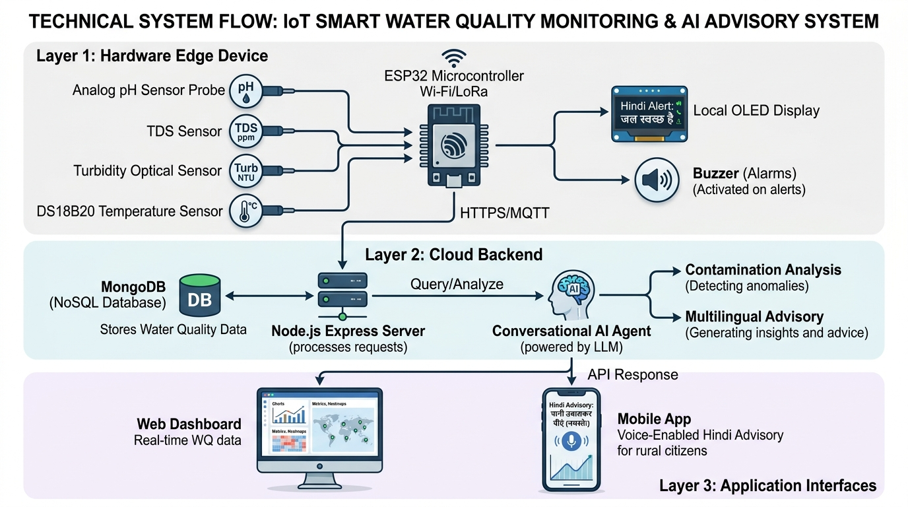
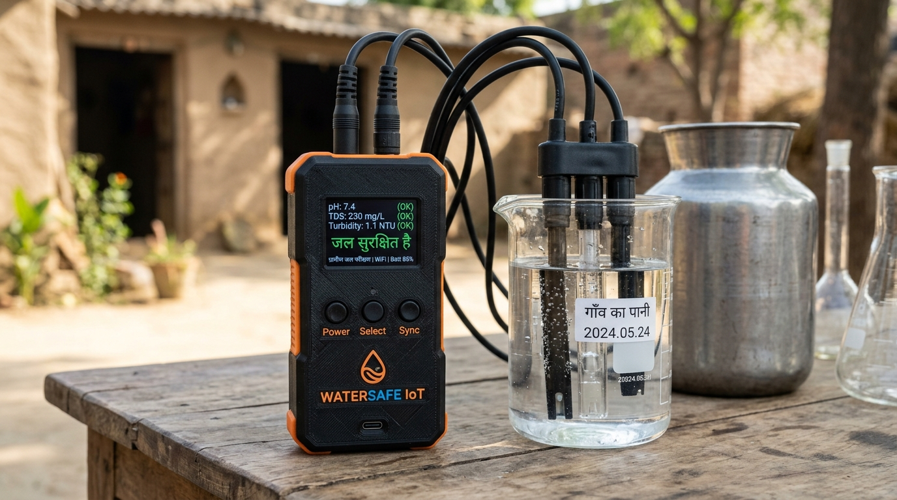

# JalRakshak AI (जल रक्षक AI) 💧🛡️

> **Autonomous Edge IoT & Conversational AI Agent for Real-Time Drinking Water Quality Monitoring in Rural Uttar Pradesh**

[](LICENSE)
[](#hardware-specifications)
[](#conversational-ai-agent-in-rural-hindi)
[](JalRakshak_AI_UPCST_Final_Application.pdf)

---

## 📌 Executive Summary

Millions of rural citizens across the Gangetic plains and Terai belt of Uttar Pradesh rely on shallow handpumps and municipal tube-wells for drinking water. Seasonal agricultural runoff, high dissolved solids, and microbial pathogens frequently breach the safe limits defined by the **Bureau of Indian Standards (BIS IS 10500:2012)**. Traditional chemical laboratory testing takes **3 to 4 weeks** per sample, leaving communities vulnerable to water-borne epidemics (diarrhea, cholera, dysentery, and fluorosis).

**JalRakshak AI** solves this critical gap by combining:
1. **Low-Cost Sub-₹3,900 Edge Sensing Hardware**: Powered by an ESP32 microcontroller with analog pH, optical turbidity, total dissolved solids (TDS), and digital temperature sensors with active thermal drift compensation.
2. **Cloud Telemetry Ingestion Hub**: A lightweight Node.js/Express REST and WebSocket gateway logging measurements to time-series databases with instantaneous threshold alerting.
3. **Autonomous Conversational AI Water Quality Advisor**: An AI agent equipped with function-calling capabilities that directly interprets telemetry data and answers queries in colloquial rural Hindi via web, mobile, voice, and WhatsApp bot.

---

## 📑 Research Proposal & Official Documents

The full 11-page research and development proposal submitted under the **UP Council of Science & Technology (UPCST)** Student Project Scheme is available in this repository:

* 📄 **[Download Full Proposal PDF (11 Pages)](JalRakshak_AI_UPCST_Final_Application.pdf)**
* 🌐 **[View Proposal Source HTML](JalRakshak_AI_UPCST_Application.html)**

---

## 🖼️ System Architecture & Prototype

### High-Level 3-Tier System Architecture


### Photorealistic 3D Prototype Design


---

## ⚙️ Three-Tier System Architecture

```
[ Water Source / Village Well ]
            │
            ▼
┌────────────────────────────────────────────────────────┐
│  Tier 1: Edge Sensing Node (ESP32)                     │
│  - Analog pH Sensor (v1.1)                             │
│  - TS-300B Optical Turbidity Sensor                    │
│  - Analog TDS Electrode                                │
│  - DS18B20 Waterproof One-Wire Temp Sensor             │
│  - Active Polynomial Thermal Drift Compensation        │
│  - Local 0.96" I2C OLED Screen for Immediate Feedback  │
└───────────────────────────┬────────────────────────────┘
                            │ WiFi 802.11 b/g/n / GSM SIM800L
                            ▼
┌────────────────────────────────────────────────────────┐
│  Tier 2: Cloud Ingestion & Alerting Engine             │
│  - Node.js & Express.js REST API Gateway               │
│  - MongoDB Time-Series Geo-Tagged Database             │
│  - Automated BIS IS 10500:2012 Threshold Evaluator     │
│  - Webhook Trigger for Panchayat & Jal Nigam Alerts    │
└───────────────────────────┬────────────────────────────┘
                            │ REST / Tool Calling
                            ▼
┌────────────────────────────────────────────────────────┐
│  Tier 3: Autonomous Conversational AI Advisor          │
│  - Function / Tool Calling Engine                      │
│  - Real-Time Retrieval: get_latest_water_report()      │
│  - Multi-Lingual Reasoning (Hindi / English Voice)     │
│  - Actionable Advisory & Escalation Protocol           │
└────────────────────────────────────────────────────────┘
```

---

## 🤖 Conversational AI Agent in Rural Hindi

Unlike static dashboards that rural villagers cannot easily interpret, **JalRakshak AI** features an autonomous AI agent capable of multi-turn reasoning and tool execution in colloquial Hindi.

### Live Interaction Scenario

**Villager (via App / WhatsApp / Voice in Hindi):**
> *"हमारा पानी थोड़ा पीला दिख रहा है और स्वाद खारा है, क्या हम इसे बच्चों को पिला सकते हैं?"*
> *(Our water looks slightly yellow and tastes salty, can we give it to our children?)*

**AI Agent (Autonomous Tool Execution):**
```python
# Agent autonomously invokes live telemetry tool
tool_call = get_latest_water_report(village_id="Bijnor_Ward_4")
# Tool Output: {"ph": 8.6, "tds": 680, "turbidity": 7.4, "temp_c": 26.2, "timestamp": "2026-10-06T23:14:00Z"}
```

**Agent Cognitive Reasoning:**
- *Turbidity = 7.4 NTU* (Exceeds BIS acceptable limit of 1.0 NTU and permissible limit of 5.0 NTU; indicates suspended sediment or microbial risk).
- *pH = 8.6* (Slightly alkaline, near upper permissible bound of 8.5).
- *TDS = 680 ppm* (High mineral/salt content causing salty taste; exceeds 500 ppm desirable limit).

**Agent Response (Spoken / Displayed in Hindi):**
> ❌ **सलाह: यह पानी अभी छोटे बच्चों के लिए बिल्कुल सुरक्षित नहीं है।**
> 
> आपके वार्ड (बिजनौर वार्ड 4) के सेंसर के अनुसार:
> - **गंदलापन (Turbidity):** 7.4 NTU (सामान्य सीमा 1 से 5 NTU से काफी ज्यादा है)
> - **खारापन (TDS):** 680 ppm (सामान्य सीमा 500 ppm से अधिक है)
> 
> **तुरंत क्या करें:**
> 1. पानी को कम से कम **10 से 15 मिनट तक तेज आंच पर उबालें** और फिर साफ सूती कपड़े या फिल्टर से छानकर ठंडा करें।
> 2. यदि संभव हो तो बच्चों को वैकल्पिक सुरक्षित हैंडपंप या आरओ का पानी ही दें।
> 3. हमने आपके ग्राम प्रधान और जल निगम को इस ट्यूबवेल की जांच के लिए स्वचालित अलर्ट भेज दिया है।

---

## 🔬 Sensor Array & Physical Measurement Boundaries

| Parameter | Sensor Component | BIS IS 10500:2012 Limits | Detection Method |
| :--- | :--- | :--- | :--- |
| **pH (Acidity/Alkalinity)** | Analog pH Meter Pro Kit (v1.1) | 6.5 – 8.5 | High-impedance glass electrode (0–14 pH) |
| **Turbidity (Clarity)** | TS-300B Optical Sensor | Acceptable: 1.0 NTU, Permissible: 5.0 NTU | 940nm IR phototransistor light scattering (0–1000 NTU) |
| **Total Dissolved Solids** | Analog TDS Probe | Acceptable: 500 ppm, Permissible: 2000 ppm | Dual-pin AC electrical conductivity with thermal comp |
| **Temperature** | DS18B20 Waterproof | Reference 25°C | Maxim Dallas 1-Wire Digital (-55°C to +125°C, ±0.5°C) |

### ⚠️ Physical Sensor Capability Clarification
Low-cost physical IoT sensors measure bulk physicochemical indicators (turbidity, TDS, pH, conductivity). They reliably flag contamination spikes, pipeline bursts, sewage ingress, and turbidity surges. However, **trace heavy metals (such as arsenic, lead, or mercury) require laboratory atomic absorption spectrometry (AAS/ICP-MS)**. JalRakshak AI explicitly operates as an early warning and continuous screening system, triggering formal laboratory testing when anomalous physical surges are detected.

---

## 💰 Hardware Bill of Materials (BOM)

Total cost per edge sensing node is engineered to be **under ₹3,900 INR**:

| Item | Component Description | Approx. Cost (INR) |
| :--- | :--- | :--- |
| 1 | ESP32 NodeMCU-32S WiFi + BLE Dual-Core Dev Board | ₹420 |
| 2 | Analog pH Sensor Kit v1.1 with BNC Composite Probe | ₹1,450 |
| 3 | TS-300B Turbidity Sensor Module with Optical Probe | ₹550 |
| 4 | Analog TDS Meter Sensor Module with Waterproof Probe | ₹420 |
| 5 | DS18B20 Digital Waterproof Temperature Sensor | ₹120 |
| 6 | 0.96 inch I2C 128x64 OLED Display Screen | ₹220 |
| 7 | IP65 Weatherproof ABS Enclosure Box + Brass Cable Glands | ₹340 |
| 8 | 5V 2A Regulated Power Supply / USB Battery Circuit | ₹280 |
| 9 | Connecting Wires, PCB Header Pins, Calibration Buffers | ₹100 |
| **Total** | **Fully Assembled JalRakshak Node** | **₹3,900 INR** |

---

## 📂 Repository Structure

```
JalRakshak-AI/
├── README.md                                  # Complete Project Documentation & Technical Overview
├── LICENSE                                    # MIT Open Source License
├── JalRakshak_AI_UPCST_Final_Application.pdf  # Complete 11-Page UPCST Research Proposal
├── JalRakshak_AI_UPCST_Application.html       # Source HTML Application Document
├── assets/
│   ├── water_iot_system_architecture.jpg      # High-Resolution System Flow Architecture
│   └── portable_water_device_prototype.jpg    # 3D Photorealistic Hardware Prototype Render
├── firmware/
│   └── esp32_water_node.ino                   # ESP32 C++ Arduino Firmware with Calibration Math
├── backend/
│   ├── server.js                              # Node.js/Express Telemetry Ingestion REST API
│   └── package.json                           # Backend Dependencies
└── ai-agent/
    ├── water_advisor.py                       # Python LangChain / Function Calling AI Agent
    └── requirements.txt                       # Agent Dependencies
```

---

## 🚀 Quick Start Guide

### 1. Flash the ESP32 Firmware
1. Open [`firmware/esp32_water_node.ino`](firmware/esp32_water_node.ino) in the Arduino IDE.
2. Install the required libraries: `OneWire`, `DallasTemperature`, `ArduinoJson`.
3. Configure your local WiFi SSID and password:
   ```cpp
   const char* ssid = "YOUR_WIFI_SSID";
   const char* password = "YOUR_WIFI_PASSWORD";
   const char* serverEndpoint = "http://YOUR_SERVER_IP:5000/api/telemetry";
   ```
4. Connect the ESP32 board and click **Upload**.

### 2. Start the Telemetry Backend
```bash
cd backend
npm install
node server.js
```
The server will start listening on port `5000` and accept telemetry POST requests at `/api/telemetry`.

### 3. Run the AI Advisor Agent
```bash
cd ai-agent
pip install -r requirements.txt
python water_advisor.py
```

---

## 👨‍💻 Project Authors & Academic Affiliation

* **Principal Student Investigator**: Saurabh Kumar  
  * Department of Computer Science & Engineering  
  * RV Institute of Technology (RVIT), Bijnor, Uttar Pradesh (Affiliated to Dr. A.P.J. Abdul Kalam Technical University - AKTU)  
  * University Roll No: `BCS23014` | AKTU Enrollment: `2305010100045`  
  * Portfolio: [my-portfolio-delta-two-55.vercel.app](https://my-portfolio-delta-two-55.vercel.app)  
  * GitHub: [@saurabh-kumar135](https://github.com/saurabh-kumar135)

---

## 📜 License

This project is open-source and released under the [MIT License](LICENSE).
